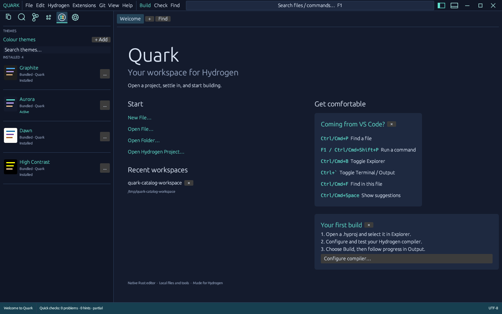

# Quark IDE

A native desktop workspace for Hydrogen, written in Rust with egui/eframe. The 0.6.0 development update adds searchable theme and extension catalogues with item options, workspace-specific enable/disable choices, removable recent items and dismissible welcome guides. The compact header, real OS terminal, separate tool-output log and four complete themes remain available. Safe saves and document recovery from 0.4.0 remain in place.

Current development status, next target and release gates are tracked in [Hydrogen — Development](https://github.com/orgs/Aurora-softwares/projects/4). A package version identifies this source; it does not imply a qualified binary release.



## Native UI migration — Visual Studio Professional-style preview

The production `quark-ide` executable remains the mature **egui/eframe** implementation. The optional `quark-native` executable is being rebuilt using real platform UI controls: **WinUI 3 / Fluent on Windows**, **AppKit on macOS**, and **GTK 4 / libadwaita on Linux**. It uses normal native window frames, menus, text controls and resizable pane splitters. The two applications share Hydrogen `.hyproj`, `.hy` and Quark `.quarkui` formats.

### Native startup window

Unlike the legacy welcome tab, the new native frontend starts with a **separate small Start Window**. The heavyweight editor and IDE shell are created only after a workspace is selected. Its Visual Studio-inspired layout has searchable **Open recent** on the left, with pinned, today, this week, this month and older groups. Choose an entry and click **Open selected**; pin/unpin and remove buttons update persistent history without deleting project files. Click a recent-project group heading to collapse or expand it; searching reveals matching entries even in collapsed groups.

**Get started** on the right includes **Clone a repository**, **Open a project or solution**, **Open a local folder**, **Create a new project**, and **Continue without code**. New projects use a separate native wizard for location, name and target. Cloning uses a separate wizard with GitHub HTTPS/SSH URL, destination and directory name; Git runs asynchronously, and successful clones open an available `.hyproj` or the cloned folder. Git must already be installed.

### Native IDE shell

The full IDE follows the **Visual Studio Professional workspace structure**, not VS Code's activity-bar model:

- Native menus: File, Edit, View, Git, Project, Build, Debug, Test, Analyze, Tools, Extensions, Window, Help
- A native icon toolbar plus a dense command strip with Debug/Release, architecture, startup project, Build, Run Without Debugging, pending debugger action and Publish
- Compact left tool-window selector for Toolbox / Server Explorer / Data Sources; centre source/designer tabs; right searchable Solution Explorer and independently resizable Properties inspector
- Resizable Output / Error List / Debug / Test Results / Find Results panes below the editor and a status bar
- Native pane divider positions are saved automatically to `native-docking.json` and restored at startup; **Window > Reset Window Layout** restores the defaults without changing projects or source files.
- A **searchable, categorized Toolbox** with 13 design-time controls (labels, buttons, text inputs, check boxes, radio buttons, combo/list boxes, slider, progress bar, image, panel and tab control), and a separate visual designer canvas. Editable X/Y/Width/Height in native Properties is validated to keep `.quarkui` layouts safe. Placing a control currently uses Toolbox select + canvas click; full cross-widget drag/drop is future work. Native and legacy Quark designers use the same control serialization, and automated tests verify round-trip compatibility.

**Implemented commands:** Build Solution, Rebuild Solution, Clean Solution, Start Without Debugging, and Bundle / Publish Binaries. They invoke the configured Hydrogen CLI on background threads. Set `QUARK_HYDROGEN_COMPILER` to the compiler executable or use `hy` on `PATH`. Build artifacts follow Hydrogen's current output planner under the project `.quark/build` directory. The Publish command **builds the current project first**, refuses to package a stale binary after a failed build, and creates a ZIP in `.quark/publish` when the build succeeds. It currently supports single-file executables, not directory-style Australis OS images.

The **Debug/Release and CPU target selectors are UI groundwork only** until the Hydrogen compiler provides verified configuration flags. The Start Debugging command is intentionally marked as not yet implemented. Do not confuse Run Without Debugging with source-level debugging.

Build this preview with `cargo run --release --features native-ui --bin quark-native`. On Ubuntu/Debian install `pkg-config libgtk-4-dev libadwaita-1-dev libpango1.0-dev libgdk-pixbuf-2.0-dev`. Windows needs a compatible Windows App SDK runtime. The existing `quark-ide` binary remains unchanged during migration.

**Current development checkpoint:** version `0.6.0`, native launcher + professional shell on a feature branch. **Next targets:** native screenshot/interaction acceptance, native editor parity, real toolbox drag/drop, persistent dock/float layouts, advanced Properties, test/Git integrations, and a Hydrogen debugger adapter. **Release gates:** all Linux/macOS/Windows formatting, Clippy, unit/coverage and release-build jobs green; manual system UI smoke tests; unsaved-buffer recovery and safe close; accessibility, theme and native packaging; source-level build/debug and interface-designer completeness. A passing build alone cannot certify native GUI behaviour.

## Start Window and visual application designer

When there is no active editor tab, Quark opens its **Start Window**. Choose **Create a new project…** to select a parent folder, a project name, and a Hydrogen target template (Linux, Windows, macOS, Australis executable or library). Quark creates a directory with `Program.hy` and a format-2 `.hyproj`, opens it in Solution Explorer, and creates a `Main.quarkui` layout. Existing folders and Hydrogen projects can be reopened using the recent-projects list.

Choose **File > New UI layout…** or **Solution Explorer > New UI** to add a `.quarkui` file to the selected project. The designer contains a **Toolbox**, **Design surface**, and **Properties** inspector. Drag a Label, Button, Text box or Check box from the toolbox onto the canvas; drag placed controls to move them, select one to edit its name, caption, position and size, and save using Ctrl/Cmd+S. The canvas can scroll when the IDE window is narrow.

**Important:** `.quarkui` is Quark's version-1 JSON design format, *not* compiled Hydrogen source. The designer provides visual layout editing and safe save/open round-trips, but automatic Hydrogen.UI code generation and native runtime previews are planned future work. Quark warns about unsaved layouts on close/exit and refuses to silently overwrite externally modified layout files. The document-recovery mechanism currently applies to source buffers rather than unsaved designer layouts.

The Debug menu distinguishes **Run without debugging** from a real debugger; source-level debugging still requires Hydrogen debug information and a supported native debugger adapter.

## Start working

1. Choose **Open Hydrogen Project** on Welcome, or **File > Open .hyproj**. For standalone work, choose Open Folder or Open File.
2. Select the project to build using the Explorer dropdown. The choices include full paths to distinguish projects with the same name.
3. Open **Hydrogen > Settings**, enter your compiler executable or absolute path, and choose **Detect / test executable**. Review the enabled commands. The SDK profile enables `build`, `check` and `run`; the conservative single-file compiler profile enables `compile`. Custom wrappers can use the capability checkboxes.
4. Choose **Build** to build the selected `.hyproj`. Shift-click Build, or choose **Compile current .hy file**, to compile only the active `.hy`. Output artifacts go under `.quark/build` with an explicit `-o` argument.
5. Read progress and failures in the bottom **Output** tab. Use **Stop job** to cancel a tool action. Use the independent **Terminal** tab for interactive commands.

Changing the executable clears its previous capabilities. Help detection is advisory: check the enabled commands against your tool's actual behavior. Quark does not install a compiler.

## Familiar controls

On macOS, use Cmd in place of Ctrl for the editor shortcuts below unless an exception is shown.

| Action | Shortcut |
| --- | --- |
| New file / Open file | Ctrl+N / Ctrl+O |
| Save / Save As | Ctrl+S / Ctrl+Shift+S |
| Save all | Ctrl+Alt+S |
| Close editor | Ctrl+W |
| Go to File | Ctrl+P |
| Command Palette | F1 or Ctrl+Shift+P |
| Sidebar / show Explorer | Ctrl+B / Ctrl+Shift+E |
| Bottom panel (Terminal / Output) | Ctrl+` (also Ctrl on macOS) |
| Find / Replace in Search sidebar | Ctrl+F / Ctrl+H |
| Workspace search sidebar | Ctrl+Shift+F |
| Next / previous match | F3 / Shift+F3 |
| Go to line | Ctrl+G |
| Next / previous tab | Ctrl+Tab / Ctrl+Shift+Tab |
| Duplicate line | Ctrl+Shift+D |
| Suggestions | Ctrl+Space |
| Word wrap | Alt+Z |
| Project build | Ctrl+Shift+B (also Ctrl on macOS) |
| Run | F5 |

The top bar combines menus and command discovery in one row. Its two right-aligned layout buttons toggle the left sidebar and bottom panel. Minimise, maximise/restore and close sit at the far right. Drag **QUARK** to move the window, double-click it to maximise/restore, or drag the window edges to resize. Settings > **Integrated window controls** switches between this compact header and your system title bar. Close retains the unsaved-work and active-session confirmation. A slim icon row inside the left sidebar selects Explorer, Search, Source Control, Plugins or Themes, with Settings alongside. The sidebar extends to the lower-left corner; Terminal / Output stay in the editor column.

F1 opens the Command Palette while editing. In the focused OS terminal, ordinary control/function keys belong to the shell/application; Ctrl/Cmd+Shift+P still opens the palette, Ctrl+Shift+B builds, Ctrl/Cmd+Shift+E shows Explorer and Ctrl/Cmd+Shift+F opens workspace search. Ctrl+` toggles the bottom panel. Go to File supports Up/Down and Enter and an Open File fallback. Help > Welcome preserves open documents.

## Welcome page preferences

Each recent workspace has an **×** button. Removing it only removes the history entry; the open workspace, build target, documents and files stay intact. Opening that workspace again restores it at the front of the list. The history keeps the 20 latest entries and displays the first ten.

The **Coming from VS Code?** and **Your first build** cards each have an **×** dismiss button. Dismissal persists across restarts. Use **Restore hidden sections** on Welcome or the two Welcome-page checkboxes in Settings to bring them back.

## Protecting your work

- Modified tabs and application exit offer **Save / Discard / Cancel**. Running commands are stopped when Quark exits normally.
- Saved files are replaced atomically using a temporary file in the same directory. Permissions and existing symlinks are preserved.
- If a saved file changed or was deleted externally, saving opens a conflict dialog. Keep your edits with Save As or explicit overwrite, reload the disk version, or cancel. The external-change check is optimistic; simultaneous writes by another program can still race the final replacement.
- Open documents, including untitled edits and their original disk baseline, are snapshotted every two seconds and restored on restart. Recovery is not a backup system; a crash can lose edits since the last snapshot, and snapshots contain your source text locally.
- Invalid settings or recovery files are preserved. A notification explains the failure and persistence pauses for that file. Repair it and restart, or use **Back up unreadable files and resume persistence** in Settings. Write failures remain visible as notifications.

Configuration and `session.json` live under:

- Linux: `$XDG_CONFIG_HOME/QuarkIDE`, or `~/.config/QuarkIDE`.
- macOS: `~/Library/Application Support/QuarkIDE`.
- Windows: `%APPDATA%\QuarkIDE`.

## Terminal and Output

The bottom panel contains a persistent Terminal, read-only Output, and a Problems view:

- **Terminal** starts the OS shell on a real pseudo-terminal: Unix PTY on Linux/macOS, ConPTY on Windows. It uses `$SHELL` (falling back to `/bin/sh`) on Unix and `%COMSPEC%` (falling back to `cmd.exe`) on Windows. `cd`, exported environment variables, shell history, interactive input and foreground processes persist while the session is open. Programs receive terminal dimensions and resize notifications. ANSI colours, cursor movement, alternate screens, application cursor keys, bracketed paste and xterm mouse reports are handled by the VT screen.
- **Problems** extracts Hydrogen `.hy` and `.hyproj` file/line error and warning messages from the latest tool job and offers clickable source navigation. Messages without a recognised location remain in Output; this is not yet a debugger or a complete Hydrogen diagnostic protocol.
- **Output** is a read-only log for Build, Compile, Check, Run, Git and plugin actions. Tool actions select this tab automatically; validation failures are logged here too. There is no command input field. Clear, Copy log and Stop job operate on the log/tool job. Tool stdout/stderr stream independently of the terminal, with 256 KiB bounded scrollback and a configurable timeout (600 seconds by default; zero disables it).

A terminal session and a tool job can run at the same time. Changing tabs or hiding the bottom panel keeps both alive. Terminal sessions are local processes and are not restored after restarting Quark. **New session** ends the old shell and starts another in the selected workspace directory; **End session** terminates it. Closing Quark warns before ending an active shell and stops ordinary foreground processes.

Click the terminal to focus it. Ctrl+C interrupts a foreground command when no text is selected; with a selection it copies. On macOS, Cmd+C copies and Ctrl+C interrupts. Clipboard paste works through the normal platform paste event; bracketed paste is used when requested by the application. Drag to select, or hold Shift to select when a terminal application captures the mouse. Mouse wheel / Shift+PageUp / Shift+PageDown navigate a bounded 2,000-row scrollback. Ctrl+L clears the shell screen. Terminal geometry is bounded to 120 rows / 400 columns; resizing uses the available grid and does not reflow old lines like a full xterm implementation.

New terminals, Git and plugins start in the selected project directory, then the first workspace folder, unless overridden in Settings or a folder's context menu. Existing terminals retain their own shell directory; switching source tabs does not change it. The terminal header describes its starting directory. Build, Check and Run use their target's directory.

## Themes

Choose the palette icon in the sidebar, **View > Themes**, or **Preferences: Themes** in the Command Palette. Search filters installed theme names and descriptions. The installed list is read-only; each item has an **...** options button.

| Included theme | Appearance | Icons |
| --- | --- | --- |
| Graphite | Neutral dark surfaces with blue accents | Outline |
| Aurora | Navy surfaces, teal accents and violet syntax | Rounded |
| Dawn | Warm light surfaces with blue accents | Rounded |
| High Contrast | Black/white surfaces with yellow accents | Solid |

Every theme and extension offers **Enable**, **Enable (Workspace)**, **Disable**, **Disable (Workspace)**, **Auto update**, **Settings**, **Open Containing Folder**, **Download ZIP** and **Remove**. Workspace options require an open workspace. Theme Enable selects that palette; disabling the active theme falls back to an available palette. Workspace overrides take precedence over global availability and use the first workspace folder as their stable identity, falling back to the first project directory. Switching the selected build target or terminal directory does not change that identity.

Theme editing is available through **... > Settings**. Customise UI surfaces, text, status, selection, errors, icon colour/style/scale, eleven syntax colour groups and the terminal's 16 ANSI colours. Changes apply live and persist after a short debounce; **Reset customisations** restores the original definition. Bundled assets are kept intact. Syntax caches and open terminal screens recolour when the effective theme changes.

**+ Add** opens local installation and future catalogue setup. **Import local theme** accepts version-1 Quark theme JSON; invalid versions, incomplete data, blank names and icon scales outside 75–150% are rejected. The four files in [assets/themes](assets/themes) are complete examples. Theme Settings can export JSON. An imported theme is installed locally and can be removed; bundled themes can be disabled and their Remove option is unavailable.

**Open Containing Folder** materialises an inspectable theme JSON snapshot under the configuration's `themes/<id>` folder and opens that folder through the OS. **Download ZIP** exports the installed theme or extension locally. ZIP export is bounded to 10,000 entries / 100 MiB and refuses symlinks. The online repositories are not configured yet: Add/discovery is an explicit placeholder and **Auto update** currently stores a preference without fetching or installing updates.

## Git and extensions

Git uses the installed CLI and system credentials. Buttons run Status, Diff, Fetch, Pull, Push and Clone into Output. Interactive credential entry for these tool jobs is disabled; configure credentials externally or run interactive Git commands in the Terminal tab. Clone adds the chosen empty destination only after success. Staging and committing use Git commands in Terminal or another Git client.

The Extensions sidebar shows installed tools in a searchable list with the same options menu as themes. **Settings** exposes action buttons and **Edit extension manifest**, which opens `plugin.json` in the editor. Save and **Reload extensions** to apply manifest changes. Actions write into Output and do not type into the OS shell. Global and workspace enable/disable choices are respected by the sidebar, top menu and action runner. **Remove** asks for confirmation and moves the extension into `extension-backups` beside the configuration; it keeps workspace files and a recoverable copy of the extension.

## Workspace, completion and diagnostics

The Search sidebar provides active-file Find/Replace and a workspace mode (Ctrl/Cmd+Shift+F). Workspace search runs in the background, uses open saved buffers ahead of disk copies, reports matching line numbers and opens the chosen line. It is case-sensitive, limited to 500 matching lines and skips binary, unreadable and over-1-MiB disk files with a notice. It searches the current workspace index; refresh or increase index limits when necessary.

Opening or saving a `.hyproj` as a file does not add a workspace project or change the selected build target. Use **Open Hydrogen Project / File > Open .hyproj** to add a project explicitly. This also applies when editing a referenced project’s manifest. An unwanted root already added by an older version can be removed through Settings without deleting its files.

Filesystem indexing, project loading and symbol extraction run in background workers. Use Explorer Refresh after external filesystem changes. Settings and context menus can remove workspace folders/projects without deleting their files. The Symbols view uses unsaved buffers when the index is refreshed.

Explorer pages large directories with **Show more**. Indexing defaults to 50,000 entries and depth 64, with notices for limits, unreadable folders and repeated/symlink directories. Increase the limit in Settings or through the notices. Generated folders (`target`, `build`, `.quark`, `node_modules`, `.venv`, `__pycache__`) are hidden by default and can be included; `.git` stays excluded. Cyclic/shared directories are not repeatedly traversed. Project references have a separate safety limit of depth 64 / 4,096 visited manifests.

Hydrogen has lexical highlighting and local keyword/identifier suggestions at the caret. Automatic suggestions can be disabled; suggestions are suppressed inside strings/comments. This is not semantic completion or an LSP.

Quick checks catch unterminated comments/literals in every open Hydrogen buffer, including untitled files and files outside the selected project. Possible-unused hints use the selected project's complete source/reference graph. The status bar identifies scanning or partial analysis; hover markers/counts for details. Compiler diagnostics remain in Output. These checks are not a complete parser or type checker.

Quark extensions are explicitly invoked external processes using the native v1 `plugin.json` protocol. **Extensions > + Add** shows the installation folder and reload controls. Place one extension subfolder there, then reload. This protocol is separate from VS Code VSIX packages. Only install tools you trust; they run with your normal user permissions. See [the example](examples/plugins/workspace-tools/plugin.json).

## Build and verify

Install Rust, Python 3 (for the feature-coverage gate), and a platform-native compiler toolchain, then run:

```sh
cargo run
./scripts/release-check.sh
```

Binary output: `target/release/quark-ide` on Linux/macOS and `target\release\quark-ide.exe` on Windows. Build on each target OS.

Linux may require native dependencies. On Ubuntu/Debian:

```sh
sudo apt install build-essential pkg-config libxkbcommon-dev libwayland-dev libx11-dev libxcursor-dev libxi-dev libxrandr-dev libgl1-mesa-dev
```

On macOS install Xcode Command Line Tools. On Windows install the MSVC Rust toolchain and Visual Studio C++ Build Tools. In PowerShell run the individual formatting, clippy, test and release-build commands from the release-check script.

See [the workspace/terminal/theme report](QUARK-WORKSPACE-UPDATE.md), [the earlier file-safety report](QUARK-RELIABILITY-UPDATE.md) and [manual acceptance checklist](scripts/manual-acceptance.md). All three OS CI jobs and the remaining native/platform/compiler acceptance gates must pass before a binary release. Large files still use egui's full-buffer text layout; highlighting is cached, but very large files can remain expensive. Quark does not yet provide an LSP, debugger, regex search, graphical Git staging/commit workflows or exhaustive xterm compatibility. See [the Visual Studio-style IDE development roadmap](QUARK-FULL-IDE-ROADMAP.md) for the planned project, launch and debugger architecture. ConPTY and native macOS terminal acceptance remain required before release.
