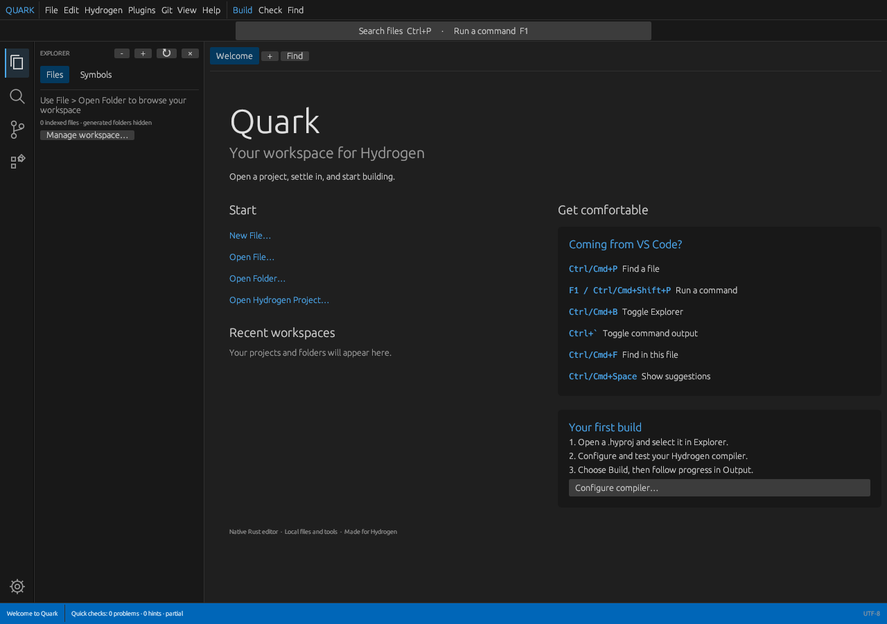

# Quark IDE

A native desktop workspace for Hydrogen, written in Rust with egui/eframe. The 0.4.0 development update adds safer file handling and a familiar dark editor layout with an activity bar, Command Palette, welcome page, scrollable tabs, file paths and a blue status bar.

Current development status, next target and release gates are tracked in [Hydrogen — Development](https://github.com/orgs/Aurora-softwares/projects/4). A package version identifies this source; it does not imply a qualified binary release.



## Start working

1. Choose **Open Hydrogen Project** on Welcome, or **File > Open .hyproj**. For standalone work, choose Open Folder or Open File.
2. Select the project to build using the Explorer dropdown. The choices include full paths to distinguish projects with the same name.
3. Open **Hydrogen > Settings**, enter your compiler executable or absolute path, and choose **Detect / test executable**. Review the enabled commands. The SDK profile enables `build`, `check` and `run`; the conservative single-file compiler profile enables `compile`. Custom wrappers can use the capability checkboxes.
4. Choose **Build** to build the selected `.hyproj`. Shift-click Build, or choose **Compile current .hy file**, to compile only the active `.hy`. Output artifacts go under `.quark/build` with an explicit `-o` argument.
5. Read progress and failures in **Output**. Use **Stop** to cancel a command.

Changing the executable clears its previous capabilities. Help detection is advisory: check the enabled commands against your tool's actual behavior. Quark does not install a compiler.

## Familiar controls

On macOS, use Cmd in place of Ctrl for the editor shortcuts below unless an exception is shown.

| Action | Shortcut |
| --- | --- |
| New file / Open file | Ctrl+N / Ctrl+O |
| Save / Save As | Ctrl+S / Ctrl+Shift+S |
| Save all | Ctrl+Alt+S |
| Close editor | Ctrl+W |
| Go to File | Ctrl+P |
| Command Palette | F1 or Ctrl+Shift+P |
| Explorer / show Explorer | Ctrl+B / Ctrl+Shift+E |
| Output | Ctrl+` (also Ctrl on macOS) |
| Find / Replace | Ctrl+F / Ctrl+H |
| Next / previous match | F3 / Shift+F3 |
| Go to line | Ctrl+G |
| Next / previous tab | Ctrl+Tab / Ctrl+Shift+Tab |
| Duplicate line | Ctrl+Shift+D |
| Suggestions | Ctrl+Space |
| Word wrap | Alt+Z |
| Project build | Ctrl+Shift+B (also Ctrl on macOS) |
| Run | F5 |

F1 opens the Command Palette; it no longer toggles the old terminal pane. Go to File supports Up/Down and Enter, indexes all file extensions and provides an Open File fallback. The activity bar contains Explorer, Find, Source Control, Plugins and Settings. Help > Welcome returns to the start page without closing documents.

## Protecting your work

- Modified tabs and application exit offer **Save / Discard / Cancel**. Running commands are stopped when Quark exits normally.
- Saved files are replaced atomically using a temporary file in the same directory. Permissions and existing symlinks are preserved.
- If a saved file changed or was deleted externally, saving opens a conflict dialog. Keep your edits with Save As or explicit overwrite, reload the disk version, or cancel. The external-change check is optimistic; simultaneous writes by another program can still race the final replacement.
- Open documents, including untitled edits and their original disk baseline, are snapshotted every two seconds and restored on restart. Recovery is not a backup system; a crash can lose edits since the last snapshot, and snapshots contain your source text locally.
- Invalid settings or recovery files are preserved. A notification explains the failure and persistence pauses for that file. Repair it and restart, or use **Back up unreadable files and resume persistence** in Settings. Write failures remain visible as notifications.

Configuration and `session.json` live under:

- Linux: `$XDG_CONFIG_HOME/QuarkIDE`, or `~/.config/QuarkIDE`.
- macOS: `~/Library/Application Support/QuarkIDE`.
- Windows: `%APPDATA%\QuarkIDE`.

## Output and Git

**Output is a command runner**, with stdout/stderr streaming, partial-line output, bounded scrollback (256 KiB), a Stop button and a configurable timeout (600 seconds by default; zero disables it). It runs one command at a time. Each command starts a fresh shell; `cd` and environment changes do not persist between commands. Interactive prompts, REPLs and full-screen programs need an external terminal.

Shell, Git and plugin commands use the folder shown in Output / Source Control. It follows the selected project directory, then the first workspace folder, unless explicitly set in Settings or a folder's context menu. Switching source tabs does not change it. Build, Check and Run use their target's directory; a running job continues to display the directory it started in.

Git uses the installed CLI and system credentials. Status, Diff, Fetch, Pull, Push and Clone are available. Interactive credential entry is disabled; configure credentials externally. Clone targets the chosen empty folder and adds it to the workspace only after success. Staging and committing currently use Git commands or an external Git client.

## Workspace, completion and diagnostics

Filesystem indexing, project loading and symbol extraction run in background workers. Use Explorer Refresh after external filesystem changes. Settings and context menus can remove workspace folders/projects without deleting their files. The Symbols view uses unsaved buffers when the index is refreshed.

Explorer pages large directories with **Show more**. Indexing defaults to 50,000 entries and depth 64, with notices for limits, unreadable folders and repeated/symlink directories. Increase the limit in Settings or through the notices. Generated folders (`target`, `build`, `.quark`, `node_modules`, `.venv`, `__pycache__`) are hidden by default and can be included; `.git` stays excluded. Cyclic/shared directories are not repeatedly traversed. Project references have a separate safety limit of depth 64 / 4,096 visited manifests.

Hydrogen has lexical highlighting and local keyword/identifier suggestions at the caret. Automatic suggestions can be disabled; suggestions are suppressed inside strings/comments. This is not semantic completion or an LSP.

Quick checks catch unterminated comments/literals in every open Hydrogen buffer, including untitled files and files outside the selected project. Possible-unused hints use the selected project's complete source/reference graph. The status bar identifies scanning or partial analysis; hover markers/counts for details. Compiler diagnostics remain in Output. These checks are not a complete parser or type checker.

Plugins are explicitly invoked external processes. Install a plugin folder containing a v1 `plugin.json` under the Plugins directory shown in Manage Plugins, then Reload. Enable/disable plugins there. Only install tools you trust; they run with your normal user permissions. See [the example](examples/plugins/workspace-tools/plugin.json).

## Build and verify

Install Rust and a platform-native compiler toolchain, then run:

```sh
cargo run
./scripts/release-check.sh
```

Binary output: `target/release/quark-ide` on Linux/macOS and `target\release\quark-ide.exe` on Windows. Build on each target OS.

Linux may require native dependencies. On Ubuntu/Debian:

```sh
sudo apt install build-essential pkg-config libxkbcommon-dev libwayland-dev libx11-dev libxcursor-dev libxi-dev libxrandr-dev libgl1-mesa-dev
```

On macOS install Xcode Command Line Tools. On Windows install the MSVC Rust toolchain and Visual Studio C++ Build Tools. In PowerShell run the individual formatting, clippy, test and release-build commands from the release-check script.

See [the change/verification report](QUARK-RELIABILITY-UPDATE.md) and [manual acceptance checklist](scripts/manual-acceptance.md). All three OS CI jobs and the remaining native/platform/compiler acceptance gates must pass before a binary release. Large files still use egui's full-buffer text layout; highlighting is cached, but very large files can remain expensive. Quark does not yet provide an LSP, debugger, persistent PTY, regex search or graphical Git staging/commit workflows.
